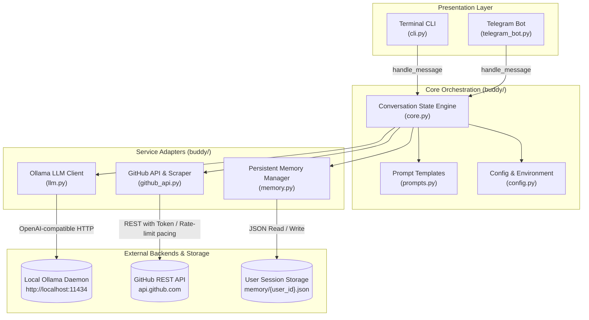
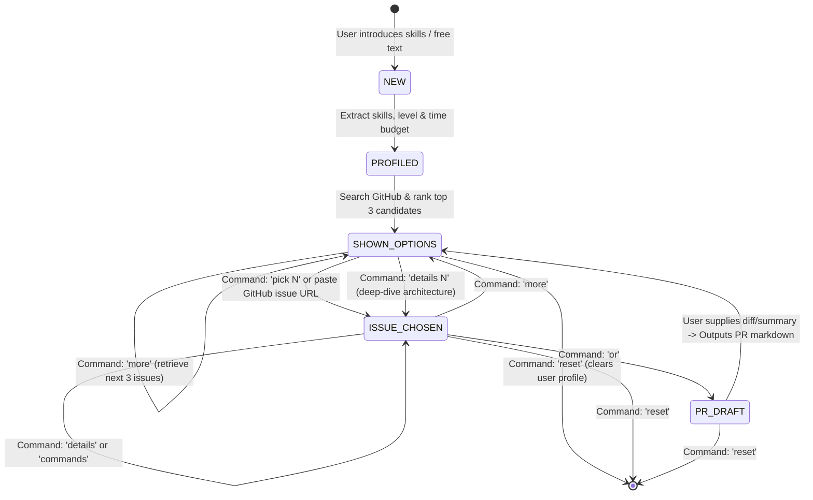

# 🎃 Hacktoberfest Buddy

> **An open-source AI mentor that guides first-time contributors through finding, understanding, and shipping their first open-source Pull Request.**

[](https://python.org)
[](https://ollama.com)
[](https://docs.github.com/en/rest)
[](https://telegram.org)
[](https://pytest.org)
[](LICENSE)

---

## 📑 Table of Contents

- [Overview](#-overview)
- [Key Features](#-key-features)
- [System Architecture](#-system-architecture)
- [Conversation State Machine](#-conversation-state-machine)
- [Interactive Commands Reference](#-interactive-commands-reference)
- [Step-by-Step Quickstart Guide](#-step-by-step-quickstart-guide)
  - [1. Prerequisites](#1-prerequisites)
  - [2. Start Ollama](#2-start-ollama)
  - [3. Install Dependencies](#3-install-dependencies)
  - [4. Configure Environment (.env)](#4-configure-environment-env)
  - [5. Run the Terminal CLI](#5-run-the-terminal-cli)
  - [6. Run the Telegram Bot](#6-run-the-telegram-bot)
  - [7. Run the Test Suite](#7-run-the-test-suite)
- [Full Conversation Walkthrough](#-full-conversation-walkthrough)
- [Project Directory Layout](#-project-directory-layout)
- [Reliability & Error Handling](#-reliability--error-handling)
- [Mentorship Guardrails & Ethics](#-mentorship-guardrails--ethics)
- [License](#-license)

---

## 🌟 Overview

Open-source contribution can be intimidating for newcomers: navigating sprawling codebases, understanding unwritten maintainer etiquette, setting up unfamiliar development environments, and finding genuinely beginner-friendly issues.

**Hacktoberfest Buddy** acts as a personalized, patient AI mentor. It runs completely locally using open-weight models via **Ollama** (e.g. `qwen3:0.6b`, `llama3.2`, `qwen2.5-coder`), requiring zero paid API subscriptions and keeping all user interactions private.

---

## ⚡ Key Features

- **Natural Intro Extraction**: Describe yourself naturally (*"I know Python and a bit of React, I have 2 hours free"*). Buddy extracts your languages, experience level, and available time into a persistent profile.
- **Instant ETA Feedback**: Users receive immediate acknowledgment (`⏳ On it! Searching GitHub and consulting your mentor... (ETA: ~10-15s)`) as soon as a query is submitted so they are never left wondering.
- **Curated Issue Search & LLM Ranking**: Searches GitHub for open, unassigned `good first issue` and `hacktoberfest` tasks, then has the local LLM evaluate and rank the top 3 with tailored rationale.
- **Detailed Architectural Deep-Dives (`details 1/2/3`)**: Request an in-depth breakdown of any issue's repository structure, affected files, root causes, and prerequisite knowledge on demand.
- **Context-Aware Git Commands (No Static Templates)**: The LLM analyzes the repository's build stack (npm/pnpm/yarn, pip/poetry/uv, cargo, go, etc.) and branch naming rules to synthesize a single copy-paste terminal setup block customized to that specific issue.
- **Step-by-Step Game Plan**: Explains what the project does, where in the codebase to look, what code to modify, how to test, and common pitfalls to avoid.
- **Maintainer Claim Comment Draft**: Pre-drafts a polite, professional comment for the contributor to post on GitHub expressing their interest and proposed plan.
- **Automated PR Description Generator**: Once your code is written, summarize your changes or paste a diff to receive a clean, structured PR description (`What this changes`, `Why (Fixes #N)`, `How tested`, `Notes`).
- **Rich Telegram Interface**: Native Telegram bot with rich HTML formatting, typing indicator, message chunking, and link preview suppression for clean mobile viewing.
- **Zero-Fallback Resilient Core**: Never swallows errors silently or falls back to low-quality generic text. Retries LLM JSON generation with temperature decay upon malformed responses.

---

## 🏗 System Architecture

The project adheres to a clean separation of concerns, decoupling the presentation channels from conversation management, external APIs, and local storage:



---

## 🔄 Conversation State Machine

User sessions transition through a state machine persisted in local JSON files:



---

## 💬 Interactive Commands Reference

Both the CLI and the Telegram bot support natural conversation and structured commands:

| Command | Aliases | Description |
|---|---|---|
| Natural sentence | _(any free text)_ | Introduce your programming languages, experience, or available time |
| `more` | `/more`, `next`, `show more` | Fetch the next 3 matching issues (excluding already shown ones) |
| `pick 1` / `pick 2` / `pick 3` | `/pick 1`, `pick #2` | Select an issue: step-by-step plan, tailored git commands & claim draft |
| `details 1` / `details 2` | `/details 1`, `describe 2` | Deep-dive architectural analysis, affected files, and prerequisites |
| `commands` / `setup` | `/setup`, `git commands` | Regenerate dynamically synthesized copy-paste terminal setup commands |
| _(Pasted GitHub Issue URL)_ | — | Analyze and explain any specific GitHub issue link directly |
| `pr` | `/pr`, `draft pr` | Enter PR drafting mode to generate a formatted PR description |
| `profile` | `/profile`, `show profile` | View your saved skills, experience level, and contribution statistics |
| `reset` | `/reset`, `start over` | Clear your saved session and start fresh |

---

## ⚡ Step-by-Step Quickstart Guide

### 1. Prerequisites
- **Python**: Version 3.10 or higher installed.
- **Ollama**: Installed locally ([Download from ollama.com](https://ollama.com)).
- **Git**: Installed and available in your terminal.

---

### 2. Start Ollama

Make sure Ollama is running in your terminal with your preferred model:

```bash
# Recommended default model:
ollama run qwen3:0.6b

# Alternatively, you can use:
ollama run llama3.2
# or
ollama run qwen2.5-coder
```

Verify that Ollama is responding:
```bash
curl http://localhost:11434/api/tags
```

---

### 3. Install Dependencies

Clone this repository and set up a Python virtual environment:

```bash
# Clone the repository
git clone https://github.com/YOUR_USERNAME/hacktoberfest-buddy.git
cd hacktoberfest-buddy

# Create a virtual environment
python -m venv .venv

# Activate the virtual environment
# Windows (PowerShell):
.venv\Scripts\Activate.ps1
# Windows (cmd):
.venv\Scripts\activate.bat
# macOS / Linux:
source .venv/bin/activate

# Install required packages
pip install -r requirements.txt
```

---

### 4. Configure Environment (.env)

Copy the example configuration:

```bash
# Windows PowerShell:
Copy-Item .env.example .env

# macOS / Linux:
cp .env.example .env
```

Open `.env` in any text editor and configure your variables:

```env
# Ollama configuration (defaults to local instance)
OLLAMA_BASE_URL=http://localhost:11434/v1
OLLAMA_MODEL=qwen3:0.6b

# GitHub personal access token (recommended: raises rate limits from 10 to 5,000 req/hr)
GITHUB_TOKEN=ghp_your_github_token_here

# Telegram bot token from @BotFather (only needed if running telegram_bot.py)
TELEGRAM_BOT_TOKEN=your_telegram_bot_token_here
```

> **How to get a GitHub Token:** Go to [GitHub Settings → Tokens (classic)](https://github.com/settings/tokens) and generate a new token with standard public read permissions.
>
> **How to get a Telegram Token:** Open Telegram, message [@BotFather](https://t.me/BotFather), send `/newbot`, and paste the generated HTTP API token.

---

### 5. Run the Terminal CLI

Start the interactive terminal mentor:

```powershell
.venv\Scripts\python.exe cli.py
```
*(On macOS/Linux: `python cli.py`)*

Type your skills to get started:
```text
You: I know Python and SQLite, I have about 2 hours free.
```

---

### 6. Run the Telegram Bot

Launch the multi-user Telegram bot:

```powershell
.venv\Scripts\python.exe telegram_bot.py
```
*(On macOS/Linux: `python telegram_bot.py`)*

1. Open Telegram and search for your bot (or [`@hacktober_bot`](https://t.me/hacktober_bot)).
2. Tap `/start`.
3. Introduce yourself and interact with your mentor on the go!

---

### 7. Run the Test Suite

Run the full automated test suite (mocked tests, no external network calls required):

```powershell
.venv\Scripts\python.exe -m pytest tests/ -v
```

All 29 tests will execute:
```text
tests/test_github_api.py::TestSearchIssues::test_basic_search_returns_results PASSED
tests/test_github_api.py::TestSearchIssues::test_deduplication PASSED
tests/test_github_api.py::TestSearchIssues::test_exclude_urls PASSED
tests/test_github_api.py::TestSearchIssues::test_body_snippet_truncated PASSED
tests/test_github_api.py::TestSearchIssues::test_sorted_by_updated PASSED
tests/test_github_api.py::TestSearchIssues::test_multiple_languages PASSED
tests/test_github_api.py::TestSearchIssues::test_rate_limit_propagates PASSED
tests/test_github_api.py::TestSearchIssues::test_api_error_propagates PASSED
tests/test_github_api.py::TestSearchIssues::test_network_error_propagates PASSED
tests/test_github_api.py::TestSearchIssues::test_empty_results PASSED
tests/test_github_api.py::TestJSONParsing::test_parse_clean_json PASSED
tests/test_github_api.py::TestJSONParsing::test_parse_json_with_fences PASSED
tests/test_github_api.py::TestJSONParsing::test_parse_json_returns_none_on_garbage PASSED
tests/test_github_api.py::TestJSONParsing::test_parse_json_dict PASSED
tests/test_github_api.py::TestJSONParsing::test_parse_json_with_backticks_only PASSED
tests/test_github_api.py::TestIntentDetection::test_more_intent PASSED
tests/test_github_api.py::TestIntentDetection::test_pick_intent PASSED
tests/test_github_api.py::TestIntentDetection::test_pick_with_hash PASSED
tests/test_github_api.py::TestIntentDetection::test_pick_url_intent PASSED
tests/test_github_api.py::TestIntentDetection::test_profile_intent PASSED
tests/test_github_api.py::TestIntentDetection::test_reset_intent PASSED
tests/test_github_api.py::TestIntentDetection::test_pr_intent PASSED
tests/test_github_api.py::TestIntentDetection::test_details_intent PASSED
tests/test_github_api.py::TestIntentDetection::test_commands_intent PASSED
tests/test_github_api.py::TestIntentDetection::test_freetext_intent PASSED
tests/test_github_api.py::TestLLMJsonRetry::test_succeeds_on_first_try PASSED
tests/test_github_api.py::TestLLMJsonRetry::test_retries_on_bad_json PASSED
tests/test_github_api.py::TestLLMJsonRetry::test_raises_after_all_retries_fail PASSED
tests/test_github_api.py::TestLLMJsonRetry::test_wrong_type_triggers_retry PASSED
============================= 29 passed in 7.88s =============================
```

---

## 💡 Full Conversation Walkthrough

### Step 1: User Introduction & Issue Recommendation
```text
You: I know Python and a bit of React, I have 2 hours

⏳ On it! Searching GitHub and consulting your mentor... (ETA: ~10-15s)

🎯 Based on your skills (Python, React) here are the best issues for you:

1. Reports: include seconds in timeline segment hover timestamps
🔗 https://github.com/HafidIdrissi/Time-Tracker/issues/356
💡 Clear issue with timeline tooltip enhancement, directly addressing a common problem for beginners.

2. Add a Security Insights v2 file
🔗 https://github.com/guardana/guardana/issues/93
💡 Documentation-focused issue matching the user's skill level and time availability.

3. feat(cli): add /stats and /compact interactive slash commands
🔗 https://github.com/OpenLucasKaka/bareloop/issues/19
💡 Feature enhancement with interactive CLI commands, a direct application of Python skills.

💡 What now? Reply with:
- pick 1, pick 2, or pick 3 to get step-by-step guidance & copy-paste git commands
- details 1, details 2, or details 3 for a deep architectural description
- more for more suggestions
- profile to see your saved skills
```

---

### Step 2: Deep Architectural Breakdown (`details 1`)
```text
You: details 1

⏳ On it! Searching GitHub and consulting your mentor... (ETA: ~10-15s)

1. Architecture & Project Overview:
   Time-Tracker is a desktop utility that records application usage and active browser tabs
   into a local SQLite database, rendering graphical timeline reports via Python.

2. Issue Deep Dive:
   Currently, hovering over timeline segments only shows hours and minutes (HH:MM).
   Contributors need to update the tooltip string formatting to include seconds (HH:MM:SS)
   for more precise inspection.

3. Affected Components & Files:
   Look inside `timetracker/reporting.py` or wherever segment tooltip rendering occurs.

4. Key Concepts & Prerequisites:
   Familiarity with Python string formatting, datetime manipulation, and basic pytest execution.

5. 🚀 One-Click Terminal Commands:
   git clone https://github.com/HafidIdrissi/Time-Tracker.git
   cd Time-Tracker
   git checkout -b fix-timeline-seconds-tooltip
   pip install -r requirements.txt
   pytest tests/test_reporting.py

6. Testing & Verification:
   Run the reporting test suite and inspect generated tooltip strings against seconds timestamps.
```

---

### Step 3: Actionable Contribution Plan & Claim Comment (`pick 1`)
```text
You: pick 1

⏳ On it! Searching GitHub and consulting your mentor... (ETA: ~10-15s)

1. What this project does:
   A private, automatic Windows time tracker for applications and browser tabs using Python and SQLite.

2. What the issue asks for:
   Add HH:MM:SS format to the timeline segment hover tooltip.

3. Step-by-step contribution plan:
   1. Fork and clone the repository.
   2. Set up the development virtual environment.
   3. Locate tooltip generation in `timetracker/reporting.py`.
   4. Update `_render_timeline_chart` to format with seconds.
   5. Run the test suite: `pytest tests/test_reporting.py -v`.
   6. Common pitfall: ensure strings remain escaped against HTML injection.

4. 🚀 One-Click Terminal Commands:
   ```bash
   git clone https://github.com/HafidIdrissi/Time-Tracker.git
   cd Time-Tracker
   git checkout -b fix-issue-356-timeline-seconds
   pip install -r requirements.txt
   pytest tests/test_reporting.py -v
   ```

5. CONTRIBUTING rules:
   Follow PEP 8 styling and verify tests pass prior to opening a PR.

6. Draft comment to claim the issue:
   "Hi @maintainer! I would love to work on this issue. I plan to update the tooltip
   formatting in reporting.py to include seconds and verify with the existing test suite.
   Could you please assign this issue to me?"
```

---

### Step 4: Draft Pull Request Description (`pr`)
```text
You: pr

Tell me what you changed (a short summary or paste your diff), and I'll draft a PR description for you.

You: I updated _render_timeline_chart in timetracker/reporting.py to include %H:%M:%S in the tooltip formatter and verified tests pass.

📋 Here's your draft PR description:

## What this changes
Updates timeline segment hover tooltips to format timestamps with seconds (%H:%M:%S) for improved precision.

## Why
Fixes #356

## How I tested it
Ran `pytest tests/test_reporting.py -v`. All unit tests passed without regressions.

## Notes
Maintained backward compatibility with existing SQLite stored formats.
```

---

## 📂 Project Directory Layout

```
hacktoberfest-buddy/
├── buddy/
│   ├── __init__.py           # Package indicator
│   ├── config.py             # Loads .env; configures Ollama, GitHub & Telegram
│   ├── llm.py                # Thin OpenAI client wrapper for Ollama with error recovery
│   ├── github_api.py         # Search query builder, rate-limit pacer, repo context scraper
│   ├── memory.py             # Per-user JSON profiles and state persistence (memory/*.json)
│   ├── prompts.py            # Mentor persona, profile extraction, ranking & plan templates
│   └── core.py               # Framework-agnostic conversation logic & state engine
├── memory/                   # Directory containing persistent user sessions
├── tests/
│   └── test_github_api.py    # 29 comprehensive unit tests (mocked, no network calls)
├── cli.py                    # Interactive terminal interface with UTF-8 encoding support
├── telegram_bot.py           # Multi-user Telegram Bot using python-telegram-bot v20+
├── requirements.txt          # Python dependencies
├── .env.example              # Environment variables template
├── .gitignore                # Protects secrets, cache files, and virtual environments
├── LICENSE                   # MIT License
└── README.md                 # Complete documentation
```

---

## 🛡 Reliability & Error Handling

- **No Silent Swallowing**: All network, API, and parsing errors are surfaced clearly with remediation guidance.
- **Defensive JSON Parsing & Retry**: `_llm_json()` retries up to 2 times with temperature decay if an LLM returns malformed JSON, preventing crashes.
- **GitHub Rate Limit Pacing**: Requests are spaced by 0.5s intervals and automatically inspect `Retry-After` headers if GitHub secondary rate limits trigger.
- **Safe HTML Converter for Telegram**: Markdown is translated into sanitized Telegram HTML (`<b>`, `<i>`, `<code>`, `<pre>`), with automatic fallback to plain text if tag mismatches occur.
- **Windows UTF-8 Terminal Support**: Reconfigures standard output and standard error to UTF-8 on Windows to eliminate `cp1252` encoding crashes.

---

## 🤝 Mentorship Guardrails & Ethics

- **Zero Auto-Submissions**: Buddy will **never** automatically open PRs, post comments, or modify GitHub repositories on the user's behalf.
- **Anti-Spam & Quality First**: Encourages high-value, meaningful contributions and actively discourages spammy single-character or AI-generated junk PRs.
- **Zero Hallucination**: If repository context lacks testing instructions or file paths, Buddy explicitly states it as a best guess rather than hallucinating details.
- **Policy Compliance**: Reminds contributors to check each project's `CONTRIBUTING.md` and AI disclosure policies before opening a Pull Request.

---

## 📄 License

Distributed under the [MIT License](LICENSE). Contributions and forks welcome!
