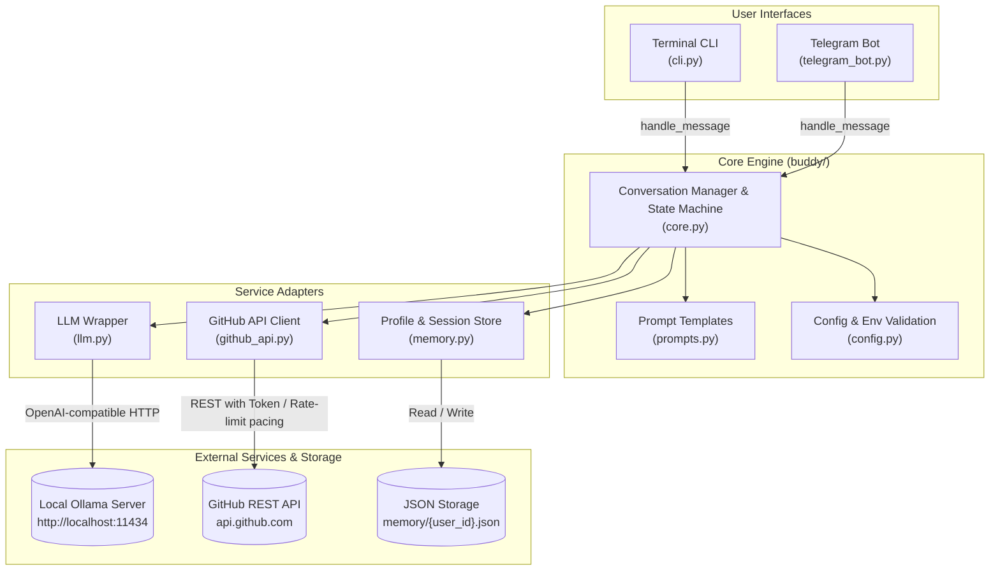
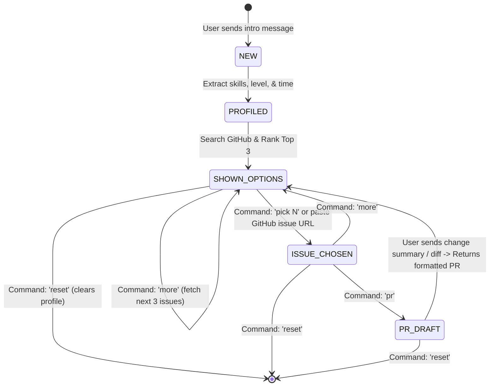

# 🎃 Hacktoberfest Buddy

> An open-source, AI-powered mentor that guides first-time contributors through finding, understanding, and shipping their first open-source Pull Request.

**Powered by local open-weight AI via Ollama** (e.g., `qwen3:0.6b`, `llama3.2`, `qwen2.5-coder`). Zero API subscription costs, zero third-party data leakage, and built with pure Python without heavy frameworks.

---

## 📖 Table of Contents
- [What It Does](#-what-it-does)
- [System Architecture](#-system-architecture)
- [Conversation State Machine](#-conversation-state-machine)
- [Prerequisites & Requirements](#-prerequisites--requirements)
- [Quickstart Guide (Exact Steps to Run)](#-quickstart-guide-exact-steps-to-run)
  - [1. Start Ollama](#1-start-ollama)
  - [2. Environment Setup](#2-environment-setup)
  - [3. Configure Environment (.env)](#3-configure-environment-env)
  - [4. Run the Terminal CLI](#4-run-the-terminal-cli)
  - [5. Run the Telegram Bot](#5-run-the-telegram-bot)
  - [6. Run Test Suite](#6-run-test-suite)
- [Interactive Commands & Intents](#-interactive-commands--intents)
- [Example Walkthrough](#-example-walkthrough)
- [Project Directory Layout](#-project-directory-layout)
- [Guardrails & Ethical Design](#-guardrails--ethical-design)
- [License](#-license)

---

## 🚀 What It Does

1. **Intelligent Profile Extraction**: The user speaks naturally (*"I know Python and a bit of React, I have 2 hours"*), and the assistant extracts skills, experience level, and time availability without rigid forms.
2. **Targeted Issue Discovery**: Queries GitHub's Search API for open, unassigned issues matching `good first issue` and `hacktoberfest` labels across user-specified languages.
3. **LLM Relevance Ranking**: The local LLM evaluates candidate issues and selects the top 3 with clear rationale tailored to the user's available time and proficiency.
4. **Deep Context & Contribution Plan**: When the user picks an issue, the bot scrapes repository metadata, issue history, comments, the `README`, and `CONTRIBUTING.md` to produce:
   - Plain-English repository summary
   - Precise issue breakdown
   - Numbered step-by-step game plan (setup, files to inspect, code changes, testing, common pitfalls)
   - Mandatory contributing policies & code styles
   - A polite, ready-to-use claim comment
5. **Automated PR Description Drafting**: After completing the fix, the user provides a brief summary or diff, and Buddy formats a professional Pull Request description (Fixes issue #, Changes Made, How Tested).
6. **Persistent Memory**: Remembers profile, previously shown issues, and attempted contributions per user so suggestions never repeat.

---

## 🏗 System Architecture

The application cleanly decouples presentation interfaces (CLI & Telegram) from domain logic, LLM operations, external APIs, and storage.



---

## 🔄 Conversation State Machine

Every user session transitions through a deterministic state machine persisted in local JSON storage:



---

## 📋 Prerequisites & Requirements

- **Python**: Version 3.10, 3.11, 3.12, or 3.13
- **Ollama**: Installed and running locally ([Download from ollama.com](https://ollama.com))
- **Operating System**: Windows, macOS, or Linux
- **GitHub Account** (Optional but recommended): Personal Access Token to raise API rate limits from 10 to 5,000 requests/hour.
- **Telegram Account** (Optional): If running the bot interface.

---

## ⚡ Quickstart Guide (Exact Steps to Run)

### 1. Start Ollama

Make sure Ollama is installed and run your model in a terminal window:

```bash
ollama run qwen3:0.6b
```
*(Alternatively, you can use `ollama run llama3.2` or `ollama run qwen2.5-coder`)*.

Verify Ollama is listening by running:
```bash
curl http://localhost:11434/api/tags
```

---

### 2. Environment Setup

Clone this repository and create a Python virtual environment:

```bash
# Clone the repository
git clone https://github.com/YOUR_USERNAME/hacktoberfest-buddy.git
cd hacktoberfest-buddy

# Create a virtual environment
python -m venv .venv

# Activate virtual environment
# On Windows (PowerShell):
.venv\Scripts\Activate.ps1
# On Windows (cmd):
.venv\Scripts\activate.bat
# On macOS / Linux:
source .venv/bin/activate

# Install dependencies
pip install -r requirements.txt
```

---

### 3. Configure Environment (.env)

Create a `.env` file from the template:

```bash
# Windows PowerShell:
Copy-Item .env.example .env

# Linux / macOS:
cp .env.example .env
```

Open `.env` and configure your settings:

```env
# Ollama endpoint & model name
OLLAMA_BASE_URL=http://localhost:11434/v1
OLLAMA_MODEL=qwen3:0.6b

# GitHub personal access token (recommended: avoids rate-limits)
GITHUB_TOKEN=ghp_your_github_token_here

# Telegram bot token from @BotFather (only needed if running telegram_bot.py)
TELEGRAM_BOT_TOKEN=your_telegram_bot_token_here
```

> **How to get a GitHub Token:** Go to [GitHub Settings → Developer Settings → Personal Access Tokens → Tokens (classic)](https://github.com/settings/tokens) and generate a token with standard public read permissions.
>
> **How to get a Telegram Token:** Open Telegram, message [@BotFather](https://t.me/BotFather), send `/newbot`, and paste the generated HTTP API token.

---

### 4. Run the Terminal CLI

To start the interactive command-line mentor:

```powershell
.venv\Scripts\python.exe cli.py
```
*(On macOS/Linux: `python cli.py`)*

Type your introduction, for example:
```
You: I know Python and SQLite, I have about 2 hours free.
```

---

### 5. Run the Telegram Bot

To launch the multi-user Telegram bot:

```powershell
.venv\Scripts\python.exe telegram_bot.py
```
*(On macOS/Linux: `python telegram_bot.py`)*

1. Open Telegram and search for your bot (or [`@hacktober_bot`](https://t.me/hacktober_bot)).
2. Tap `/start`.
3. Introduce yourself and start exploring issues!

---

### 6. Run Test Suite

Run the full automated test suite (mocked tests, no external network calls required):

```powershell
.venv\Scripts\python.exe -m pytest tests/ -v
```

All 27 test cases will execute:
- GitHub issue search query builder & label filters
- Duplicate issue elimination & exclusion logic
- API rate-limit error propagation
- Strict JSON response extraction & retry recovery
- Natural language intent detection

---

## 💬 Interactive Commands & Intents

Both the CLI and the Telegram bot support natural conversation as well as instant commands:

| Command | Shorthand | Action |
|---|---|---|
| Natural sentence | _(free text)_ | Introduce skills/level/time or chat with mentor |
| `more` | `/more`, `next` | Retrieve the next 3 matching issues (avoids already seen) |
| `pick 1` / `pick 2` / `pick 3` | `/pick 1` | Deep-dive into an issue: plan, code tips, claim draft |
| _(Pasted GitHub URL)_ | — | Deep-dive into any specific GitHub issue URL |
| `pr` | `/pr` | Enter PR drafting mode to generate a PR description |
| `profile` | `/profile` | Display saved skills, experience level, and stats |
| `reset` | `/reset` | Clear stored session and restart fresh |

---

## 💡 Example Walkthrough

```text
============================================================
  Hacktoberfest Buddy - CLI
  Your AI mentor for first open-source contributions.
============================================================

You: I know Python and a bit of React, I have 2 hours

Buddy is thinking...

🎯 Based on your skills (Python, React) here are the best issues for you:

1. Reports: include seconds in timeline segment hover timestamps
   https://github.com/HafidIdrissi/Time-Tracker/issues/356
   → Clear issue with timeline tooltip enhancement, directly addressing a common problem for beginners.

2. Add a Security Insights v2 file
   https://github.com/guardana/guardana/issues/93
   → Documentation-focused issue matching the user's skill level and time availability.

3. feat(cli): add /stats and /compact interactive slash commands
   https://github.com/OpenLucasKaka/bareloop/issues/19
   → Feature enhancement with interactive CLI commands, a direct application of Python skills.

💡 Reply: pick 1, pick 2, pick 3, or paste a GitHub issue URL

You: pick 1

Buddy is thinking...

1. What this project does:
   A private, automatic Windows time tracker for applications and browser tabs, using Python and SQLite.

2. What the issue asks for:
   Add HH:MM:SS format to timeline segment hover tooltips.

3. Step-by-step plan:
   1. Fork and clone the repository.
   2. Set up the virtual environment: pip install -r requirements.txt.
   3. Where to look: likely `timetracker/reporting.py`.
   4. What to change: update `_render_timeline_chart` to format seconds.
   5. How to test: run `pytest tests/test_reporting.py -v`.
   6. Pitfalls: prevent HTML unescaped string injection in tooltips.

4. Draft comment to claim the issue:
   "Hi @maintainer! I'd love to work on this issue. I plan to update the tooltip formatter in reporting.py to include seconds. Could you please assign this to me?"

You: pr

Buddy: Tell me what you changed (a short summary or paste your diff)...

You: I updated _render_timeline_chart in reporting.py to format timestamps with %H:%M:%S and ran the test suite.

Buddy:
📋 Here's your draft PR description:

## What this changes
Updated timeline segment tooltips to include seconds (%H:%M:%S) for granular time inspection.

## Why
Fixes #356

## How I tested it
Ran pytest test suite: all 14 reporting tests passed without regression.

## Notes
Maintained backward compatibility with existing SQLite datetime storage formats.
```

---

## 📂 Project Directory Layout

```
hacktoberfest-buddy/
├── buddy/
│   ├── __init__.py           # Package indicator
│   ├── config.py             # Loads .env, validates Ollama, GitHub, and Telegram tokens
│   ├── llm.py                # Thin OpenAI client wrapper for Ollama with error recovery
│   ├── github_api.py         # Search query builder, rate-limit pacer, repo context scraper
│   ├── memory.py             # User profile and session tracking (stored in memory/*.json)
│   ├── prompts.py            # Mentor persona, profile extraction, ranking & plan templates
│   └── core.py               # Framework-agnostic conversation logic & state engine
├── memory/                   # Directory containing persistent user sessions
├── tests/
│   └── test_github_api.py    # 27 comprehensive unit tests (mocked, no network calls)
├── cli.py                    # Interactive terminal interface with UTF-8 encoding support
├── telegram_bot.py           # Multi-user Telegram Bot using python-telegram-bot v20+
├── requirements.txt          # Python dependencies
├── .env.example              # Environment variables template
├── .gitignore                # Protects secrets, cache files, and virtual environments
├── LICENSE                   # MIT License
└── README.md                 # Complete documentation
```

---

## 🛡 Guardrails & Ethical Design

- **Zero Auto-Submissions**: Buddy will **never** automatically open PRs, post comments, or modify GitHub repositories on the user's behalf.
- **Anti-Spam & Quality First**: Strictly encourages high-value contributions and discourages spammy single-character or AI-generated junk PRs.
- **No Fabrications**: If repository context lacks testing instructions or file trees, Buddy explicitly states it as a best guess rather than hallucinating details.
- **Policy Compliance**: Reminds contributors to check each project's `CONTRIBUTING.md` and AI disclosure rules before submitting.

---

## 📄 License

Distributed under the [MIT License](LICENSE). Contributions welcome!
